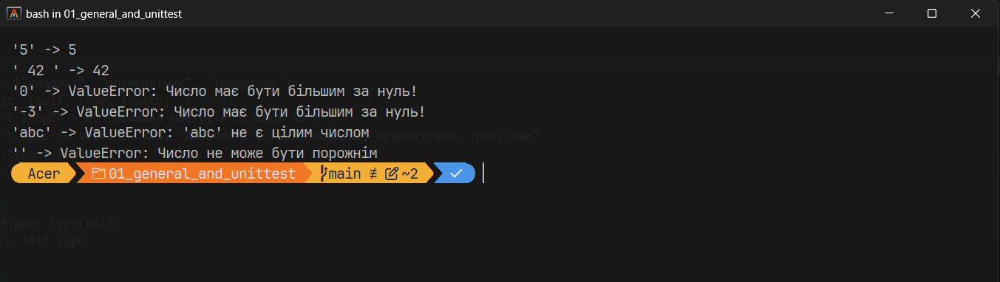
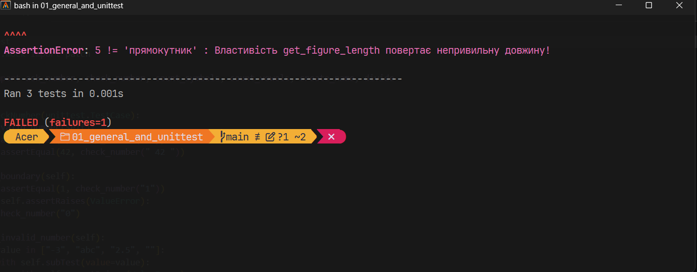
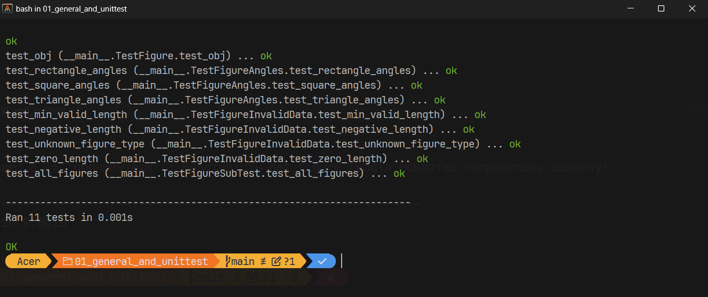
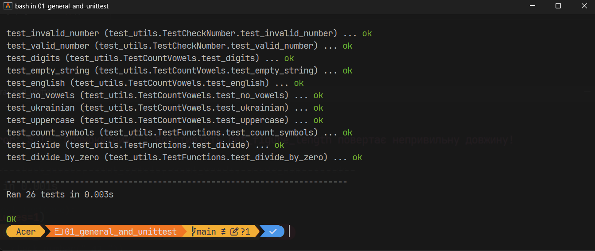
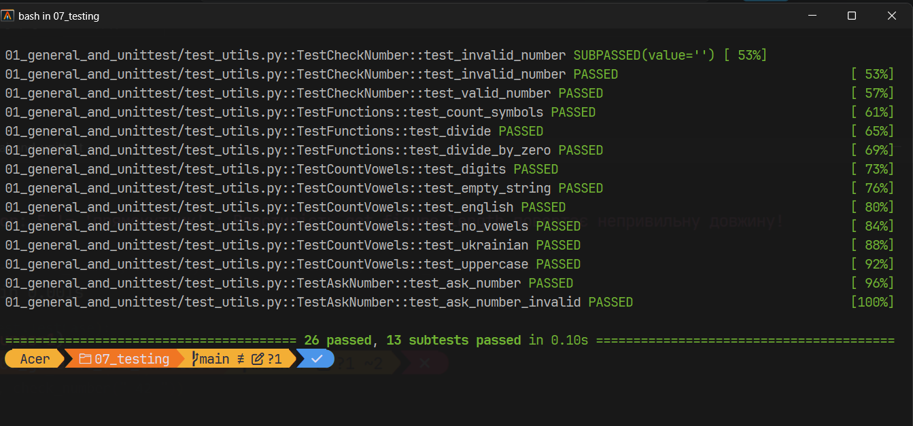

# Звіт до роботи
## Тема: _Загальне тестування та юніт-тести (unittest)_
### Мета роботи: _ознайомитися з перевіркою даних за допомогою `assert` та `raise`, навчитися писати юніт-тести з бібліотекою `unittest`, використовувати життєвий цикл тесту, `subTest` та `unittest.mock`_

---
### Виконання роботи

**Середовище:** Windows, VS Code, Python 3.14 (зафіксовано в [`pyproject.toml`](../pyproject.toml): `requires-python = ">=3.14,<4.0"`), Poetry. Робота виконується в одному Poetry-проєкті [`07_testing`](../) для всіх чотирьох частин: `flask` — основна залежність, `pytest`, `pytest-cov`, `coverage` — група `dev`. Налаштування `pytest` і `coverage` винесено в `pyproject.toml`, команди — у [`Makefile`](../Makefile).

```bash
poetry add flask
poetry add --group dev pytest pytest-cov coverage
poetry install
```

Файли частини:
- [`app.py`](./app.py) — клас `Figure`, у якому я виправив помилку та додав властивість `get_angles`;
- [`test.py`](./test.py) — тести класу `Figure`;
- [`utils.py`](./utils.py) — функції для завдань «Перевірка даних», «Тестування функцій» і mock;
- [`test_utils.py`](./test_utils.py) — тести для `utils.py`.

### Розділ 1: Перевірка даних

1. **`assert`** перевіряє твердження і зупиняє програму з `AssertionError`, якщо умова хибна. Саме так у класі `Figure` перевіряються довжина та тип фігури.
2. **`raise ValueError`** використано у функції `create_name` — повідомляє, що аргумент неправильний.
3. :star: **Власна перевірка введеного числа** — функція `check_number` у [`utils.py`](./utils.py):
    ```python
    def check_number(value: str) -> int:
        """Перевіряє введене число: має бути цілим і більшим за нуль."""
        value = value.strip()
        if not value:
            raise ValueError("Число не може бути порожнім")
        try:
            number = int(value)
        except ValueError:
            raise ValueError(f"'{value}' не є цілим числом")
        if number <= 0:
            raise ValueError("Число має бути більшим за нуль!")
        return number
    ```
    Для перевірки тут обрано `raise ValueError`, а не `assert`: це перевірка даних від користувача, і вона має працювати завжди (`assert` вимикається при запуску `python -O`).

    Результат для правильного та неправильного введення (`python utils.py`):
    ```text
    '5' -> 5
    ' 42 ' -> 42
    '0' -> ValueError: Число має бути більшим за нуль!
    '-3' -> ValueError: Число має бути більшим за нуль!
    'abc' -> ValueError: 'abc' не є цілим числом
    '' -> ValueError: Число не може бути порожнім
    ```
    Правильне число (зокрема з пробілами по краях) повертається як `int`; нуль, від'ємне число, текст і порожній рядок дають `ValueError` з поясненням.

    

### Розділ 2: Тестування функцій

1. Для кожної функції спочатку визначено очікуваний результат для звичайних, порожніх і граничних даних, потім написано тест у класі, який наслідує `unittest.TestCase` ([`test_utils.py`](./test_utils.py)):
    ```python
    class TestFunctions(unittest.TestCase):
        def test_count_symbols(self):
            self.assertEqual(3, count_symbols("abc"))
            self.assertEqual(0, count_symbols(""))

        def test_divide(self):
            self.assertEqual(2, divide(10, 5))

        def test_divide_by_zero(self):
            with self.assertRaises(ZeroDivisionError):
                divide(1, 0)
    ```
    Крім правильних даних перевіряється й помилка: ділення на нуль має давати `ZeroDivisionError`.

2. :star: **Функція підрахунку голосних** `count_vowels` — рахує англійські та українські голосні без урахування регістру:
    ```python
    VOWELS = "aeiouаеєиіїоуюя"  # англійські + українські голосні

    def count_vowels(text: str) -> int:
        return sum(1 for letter in text.lower() if letter in VOWELS)
    ```
3. :star: :fire: **Тести для `count_vowels`** — звичайний рядок, великі літери, рядок без голосних, порожній рядок, рядок із цифрами та рядок з українськими літерами:
    ```python
    class TestCountVowels(unittest.TestCase):
        def test_english(self):
            self.assertEqual(2, count_vowels("hello"))

        def test_uppercase(self):
            self.assertEqual(5, count_vowels("AEIOU"))

        def test_no_vowels(self):
            self.assertEqual(0, count_vowels("rhythm"))

        def test_empty_string(self):
            self.assertEqual(0, count_vowels(""))

        def test_digits(self):
            self.assertEqual(0, count_vowels("12345"))
            self.assertEqual(2, count_vowels("a1b2e3"))

        def test_ukrainian(self):
            self.assertEqual(3, count_vowels("Маркіян"))
            self.assertEqual(5, count_vowels("їжак є юла"))
    ```

### Розділ 3: Перший приклад (клас `Figure`)

1. **Створення об'єктів і ручна перевірка властивостей** (`python app.py`):
    ```text
    квадрат: довжина = 5, кутів = 4
    прямокутник: довжина = 10, кутів = 4
    трикутник: довжина = 3, кутів = 3
    ```
2. **Тести у [`test.py`](./test.py)**: `unittest.TestCase` дає готові методи `assertEqual`, `assertIn`, `assertRaises`. У `setUp` перед кожним тестом створюється випадкова фігура з випадковою довжиною, у `tearDown` об'єкт видаляється.

3. :star: **Тест довжини, який не проходив.** У прикладі викладача тест `test_figure_lengh` був закоментований. Після розкоментування запуск `python test.py` показав помилку:
    ```text
    test_figure_lengh (__main__.TestFigure.test_figure_lengh) ... FAIL
    test_figure_type (__main__.TestFigure.test_figure_type) ... ok
    test_obj (__main__.TestFigure.test_obj) ... ok

    ======================================================================
    FAIL: test_figure_lengh (__main__.TestFigure.test_figure_lengh)
    ----------------------------------------------------------------------
    Traceback (most recent call last):
      File "D:\College\Бугиль\02_Готові\07_testing\01_general_and_unittest\test.py", line 30, in test_figure_lengh
        self.assertEqual(self.length, self.obj.get_figure_length, "Властивість get_figure_length повертає непривильну довжину!")
        ~~~~~~~~~~~~~~~~^^^^^^^^^^^^^^^^^^^^^^^^^^^^^^^^^^^^^^^^^^^^^^^^^^^^^^^^^^^^^^^^^^^^^^^^^^^^^^^^^^^^^^^^^^^^^^^^^^^^^^^^
    AssertionError: 9 != 'квадрат' : Властивість get_figure_length повертає непривильну довжину!

    ----------------------------------------------------------------------
    Ran 3 tests in 0.001s

    FAILED (failures=1)
    Тестуємо вивід, має бути: квадрат == квадрат
    ```
    Фігура і довжина в `setUp` випадкові, тому значення від запуску до запуску різні. Тут тест очікував довжину `9`, а отримав рядок `'квадрат'` (на рис. 2 — інший запуск: `5 != 'прямокутник'`): властивість `get_figure_length` повертала тип фігури замість довжини. Виправлення в [`app.py`](./app.py):
    ```python
    @property
    def get_figure_length(self):
        return self.length # виправлено: раніше повертався self.type
    ```
    Після виправлення тест проходить (див. загальний результат нижче).

    

    

4. :star: **Властивість `get_angles` і тести для квадрата, прямокутника та трикутника:**
    ```python
    @property
    def get_angles(self):
        """Кількість кутів фігури."""
        if self.type in ["квадрат", "прямокутник"]:
            return 4
        if self.type == "трикутник":
            return 3
        return 0
    ```
    ```python
    class TestFigureAngles(unittest.TestCase):
        def test_square_angles(self):
            self.assertEqual(4, Figure("квадрат", 5).get_angles)

        def test_rectangle_angles(self):
            self.assertEqual(4, Figure("прямокутник", 7).get_angles)

        def test_triangle_angles(self):
            self.assertEqual(3, Figure("трикутник", 3).get_angles)
    ```
5. :fire: **Тести для нульової, від'ємної довжини та невідомого типу фігури** (а також мінімальної допустимої довжини `1` як граничного значення):
    ```python
    class TestFigureInvalidData(unittest.TestCase):
        def test_zero_length(self):
            with self.assertRaises(AssertionError):
                Figure("квадрат", 0)

        def test_negative_length(self):
            with self.assertRaises(AssertionError):
                Figure("трикутник", -5)

        def test_unknown_figure_type(self):
            with self.assertRaises(AssertionError) as context:
                Figure("ромб", 3)
            self.assertIn("Дозволені фігури", str(context.exception))

        def test_min_valid_length(self):
            self.assertEqual(1, Figure("квадрат", 1).get_figure_length)
    ```

### Розділ 4: Життєвий цикл тесту
У [`test.py`](./test.py) використано методи життєвого циклу:
- `setUpClass` — виконується один раз перед усіма тестами класу `TestFigure`;
- `setUp` — перед кожним тестом створює новий об'єкт `Figure`, тому тести не залежать один від одного;
- `tearDown` — після кожного тесту видаляє об'єкт.

Усі методи тестів починаються з `test_`, інакше `unittest` їх не знайде.

### Розділ 5: Розширені можливості unittest

1. :star: **`subTest` для всіх типів `Figure`:**
    ```python
    class TestFigureSubTest(unittest.TestCase):
        def test_all_figures(self):
            expected_angles = {"квадрат": 4, "прямокутник": 4, "трикутник": 3}
            for figure_type in Figure.FIGURES:
                for length in [1, 5, 10]:
                    with self.subTest(figure=figure_type, length=length):
                        fig = Figure(figure_type, length)
                        self.assertEqual(figure_type, fig.get_figure_type)
                        self.assertEqual(length, fig.get_figure_length)
                        self.assertEqual(expected_angles[figure_type], fig.get_angles)
    ```
    **Призначення `subTest`:** один тест перебирає 9 наборів даних (3 фігури × 3 довжини). Без `subTest` тест зупинився б на першій помилці і не було б видно, на якому саме наборі вона сталася. З `subTest` перевіряються всі набори, а в звіті про помилку вказано параметри, наприклад `(figure='трикутник', length=5)`.

2. :star: **Функція з `input()` і тест через `patch`:**
    ```python
    def ask_number() -> int:
        """Просить користувача ввести число і повертає перевірене значення."""
        return check_number(input("Введіть додатне число: "))
    ```
    ```python
    class TestAskNumber(unittest.TestCase):
        @patch("builtins.input", return_value="5")
        def test_ask_number(self, mock_input):
            self.assertEqual(5, ask_number())
            mock_input.assert_called_once_with("Введіть додатне число: ")

        @patch("builtins.input", return_value="-1")
        def test_ask_number_invalid(self, mock_input):
            with self.assertRaises(ValueError):
                ask_number()
            mock_input.assert_called_once()
    ```
    **Призначення `mock`:** `patch("builtins.input", ...)` на час тесту підміняє вбудовану `input` об'єктом-заглушкою, який одразу повертає `"5"` (або `"-1"`). Тест не чекає ручного введення і завжди дає однаковий результат. `assert_called_once_with` додатково перевіряє, що функція запитала введення рівно один раз і з правильним текстом. Підміняється лише зовнішня залежність (введення користувача), а власна логіка `check_number` перевіряється по-справжньому.

### Розділ 6: Запуск тестів

**Команди запуску** (з папки `07_testing`):
```bash
cd 01_general_and_unittest
poetry run python test.py
poetry run python -m unittest -v
cd ..
make test
```

**Результат `python -m unittest -v`:**
```text
test_figure_lengh (test.TestFigure.test_figure_lengh) ... ok
test_figure_type (test.TestFigure.test_figure_type) ... ok
test_obj (test.TestFigure.test_obj) ... ok
test_rectangle_angles (test.TestFigureAngles.test_rectangle_angles) ... ok
test_square_angles (test.TestFigureAngles.test_square_angles) ... ok
test_triangle_angles (test.TestFigureAngles.test_triangle_angles) ... ok
test_min_valid_length (test.TestFigureInvalidData.test_min_valid_length) ... ok
test_negative_length (test.TestFigureInvalidData.test_negative_length) ... ok
test_unknown_figure_type (test.TestFigureInvalidData.test_unknown_figure_type) ... ok
test_zero_length (test.TestFigureInvalidData.test_zero_length) ... ok
test_all_figures (test.TestFigureSubTest.test_all_figures) ... ok
test_ask_number (test_utils.TestAskNumber.test_ask_number) ... ok
test_ask_number_invalid (test_utils.TestAskNumber.test_ask_number_invalid) ... ok
test_boundary (test_utils.TestCheckNumber.test_boundary) ... ok
test_create_name (test_utils.TestCheckNumber.test_create_name) ... ok
test_invalid_number (test_utils.TestCheckNumber.test_invalid_number) ... ok
test_valid_number (test_utils.TestCheckNumber.test_valid_number) ... ok
test_digits (test_utils.TestCountVowels.test_digits) ... ok
test_empty_string (test_utils.TestCountVowels.test_empty_string) ... ok
test_english (test_utils.TestCountVowels.test_english) ... ok
test_no_vowels (test_utils.TestCountVowels.test_no_vowels) ... ok
test_ukrainian (test_utils.TestCountVowels.test_ukrainian) ... ok
test_uppercase (test_utils.TestCountVowels.test_uppercase) ... ok
test_count_symbols (test_utils.TestFunctions.test_count_symbols) ... ok
test_divide (test_utils.TestFunctions.test_divide) ... ok
test_divide_by_zero (test_utils.TestFunctions.test_divide_by_zero) ... ok

----------------------------------------------------------------------
Ran 26 tests in 0.001s

OK
Тестуємо вивід, має бути: квадрат == квадрат
```



`pytest` також знаходить і запускає тести `unittest` (у `pyproject.toml` до `python_files` додано `test.py`). Результат `make test`: `26 passed, 13 subtests passed`.



---
### Висновок:
- :question: **Що зроблено в роботі:** налаштовано Poetry-проєкт для роботи №07 (залежності розділено на основну та `dev`-групу, конфігурацію `pytest`/`coverage` винесено в `pyproject.toml`, створено `Makefile`). Реалізовано перевірку введеного числа через `raise ValueError`, функцію підрахунку голосних, знайдено та виправлено помилку в `get_figure_length`, додано властивість `get_angles`. Написано 26 юніт-тестів на `unittest`, зокрема для порожніх, граничних і помилкових даних, тест із `subTest` та тести з `unittest.mock.patch`.
- :question: **Чи досягнуто мети роботи:** так, мету досягнуто: опановано перевірку даних і написання юніт-тестів з `unittest`.
- :question: **Які нові знання отримано:** різниця між `assert` (перевірка внутрішніх припущень, вимикається з `-O`) і `raise ValueError` (перевірка аргументів); методи життєвого циклу `setUp`/`tearDown`/`setUpClass`/`tearDownClass`; `assertRaises` як менеджер контексту з доступом до винятку; `subTest` для перевірки кількох наборів даних в одному тесті; підміна `input` через `patch` і перевірка викликів mock-об'єкта.
- :question: **Чи вдалось відповісти на всі питання задані в ході роботи:** так, на всі питання методички дано відповіді у відповідних розділах звіту.
- :question: **Чи вдалося виконати всі завдання:** так, виконано всі завдання, позначені :star:, і завдання підвищеної складності :fire:.
- :question: **Чи виникли складності у виконанні завдання:** у прикладі `example/testing/01_general_and_unittest` тест довжини вже розкоментований і помилки немає, тому помилку я шукав у версії цього прикладу з `example/coverage_io`.
- :question: **Чи подобається такий формат здачі роботи (Feedback):** так, формат зручний.
- :question: **Побажання для покращення (Suggestions):** синхронізувати код прикладу в `example/testing/01_general_and_unittest` з текстом методички.

---
