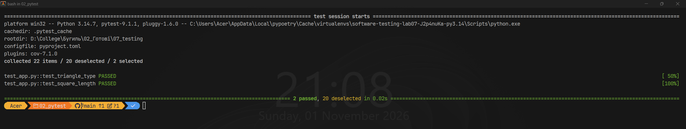
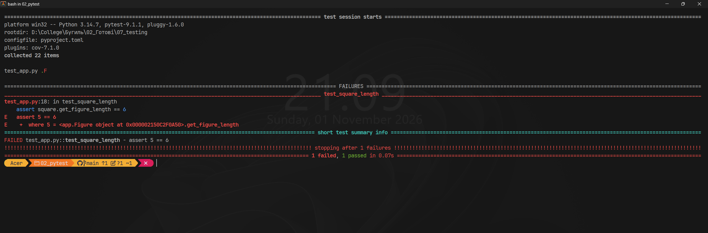
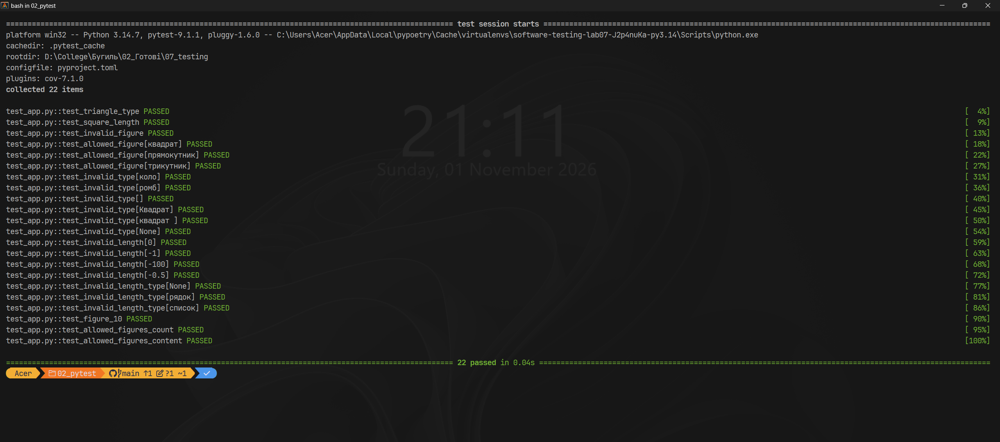
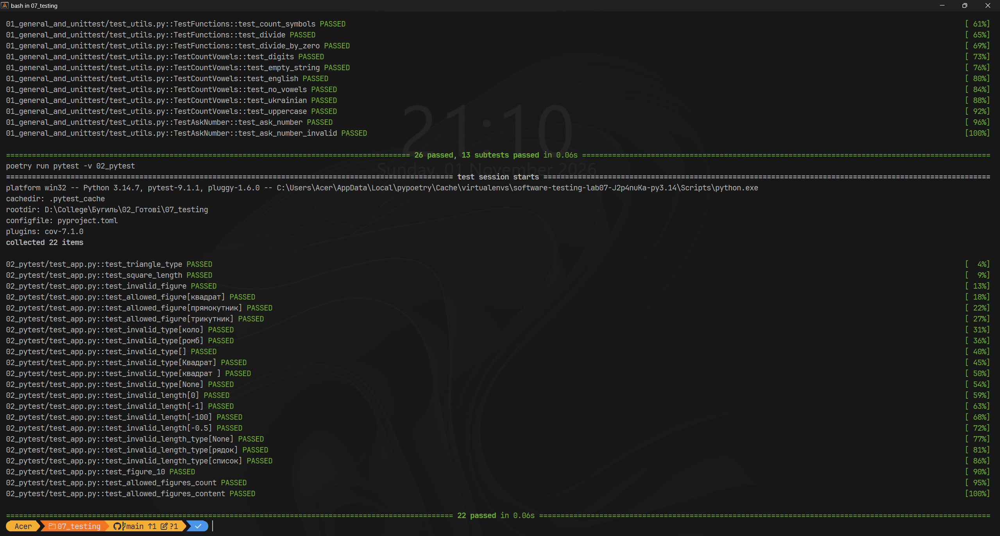

# Звіт до роботи
## Тема: _Тестування з бібліотекою pytest_
### Мета роботи: _навчитися писати тести у вигляді функцій з бібліотекою `pytest`, використовувати параметризацію, fixtures з різною областю дії, маркери та файл `conftest.py`_

---
### Виконання роботи

**Середовище:** Windows, VS Code, Python 3.14, Poetry. Частина виконується в тому самому Poetry-проєкті [`07_testing`](../), що й попередня.

Файли частини:
- [`app.py`](./app.py) — клас `Figure`;
- [`conftest.py`](./conftest.py) — спільні fixtures;
- [`test_app.py`](./test_app.py) — тести.

### Розділ 1: Встановлення

`pytest` встановлено як залежність для розробки (група `dev`), бо він потрібен лише для тестування, а не для роботи програми:
```bash
poetry add --group dev pytest
```
Налаштування `pytest` зберігаються в [`pyproject.toml`](../pyproject.toml) у секції `[tool.pytest.ini_options]`: шаблони назв файлів тестів, маркери `unit` та `integration`. Там же ввімкнено опцію, щоб у назвах параметризованих тестів кирилиця показувалась як є, а не у вигляді `кв...`.

### Розділ 2: Основи

1. Тест у `pytest` — звичайна функція з назвою `test_...` у файлі `test_*.py`. Для перевірки достатньо `assert`:
    ```python
    @pytest.mark.unit
    def test_triangle_type():
        assert Figure("трикутник", 4).type == "трикутник"
    ```
2. Виняток перевіряється через `pytest.raises`:
    ```python
    def test_invalid_figure():
        with pytest.raises(AssertionError):
            Figure("коло", 1)
    ```
3. Запуск одного тесту:
    ```bash
    poetry run pytest test_app.py::test_triangle_type -v
    ```
    ```text
    test_app.py::test_triangle_type PASSED                                   [100%]

    ============================== 1 passed in 0.03s ==============================
    ```

**Різниця між `unittest.TestCase` і функцією `pytest`:**

| | `unittest` | `pytest` |
|---|---|---|
| Оформлення тесту | метод класу, що наслідує `unittest.TestCase` | звичайна функція `test_...` |
| Перевірка | спеціальні методи `assertEqual`, `assertIn`, `assertRaises` | звичайний `assert`; при падінні pytest сам показує обидва значення |
| Підготовка даних | `setUp` / `tearDown` у класі | fixtures, які тест отримує через аргументи |
| Кілька наборів даних | цикл із `subTest` | `@pytest.mark.parametrize`, кожен набір — окремий тест |
| Встановлення | входить у стандартну бібліотеку | стороння бібліотека; уміє запускати й тести `unittest` |

### Розділ 3: Параметризація та fixtures

1. :star: **Параметризований тест для всіх дозволених фігур:**
    ```python
    @pytest.mark.parametrize("figure_type", Figure.FIGURES)
    def test_allowed_figure(figure_type):
        figure = Figure(figure_type, 1)
        assert figure.type == figure_type
        assert figure.get_figure_length == 1
    ```
    Pytest створює з однієї функції три окремі тести: `test_allowed_figure[квадрат]`, `[прямокутник]`, `[трикутник]`. Якщо впаде один набір, решта все одно виконається.

2. :star: **Fixture, яка повертає фігуру з довжиною 10.** Fixtures винесено у [`conftest.py`](./conftest.py), тому в тестах їх не треба імпортувати. `figure_10` залежить від іншої fixture, `length`, і pytest сам готує їх у правильному порядку:
    ```python
    @pytest.fixture
    def length():
        return 10

    @pytest.fixture
    def figure_10(length):
        """Фігура з довжиною 10; залежить від fixture length."""
        return Figure("прямокутник", length)
    ```
    ```python
    def test_figure_10(figure_10, length):
        assert figure_10.type == "прямокутник"
        assert figure_10.length == length == 10
        assert figure_10.get_figure_length == 10
    ```
    Тест і `figure_10` обидва запитують `length`. У межах одного тесту pytest створює `length` лише раз і передає той самий результат обом.

3. :fire: **Тести для кожного неправильного типу та кожного неправильного значення довжини:**
    ```python
    INVALID_TYPES = ["коло", "ромб", "", "Квадрат", "квадрат ", None]
    INVALID_LENGTHS = [0, -1, -100, -0.5]

    @pytest.mark.parametrize("figure_type", INVALID_TYPES)
    def test_invalid_type(figure_type):
        with pytest.raises(AssertionError, match="Невідомий тип фігури"):
            Figure(figure_type, 5)

    @pytest.mark.parametrize("length", INVALID_LENGTHS)
    def test_invalid_length(length):
        with pytest.raises(AssertionError, match="Довжина має бути більшою за 0!"):
            Figure("квадрат", length)

    @pytest.mark.parametrize("length", [None, "5", [5]], ids=["None", "рядок", "список"])
    def test_invalid_length_type(length):
        with pytest.raises(TypeError):
            Figure("квадрат", length)
    ```
    Неправильні типи: невідома фігура, порожній рядок, інший регістр (`"Квадрат"`), зайвий пробіл і `None`. Неправильні довжини: нуль (граничне значення), від'ємні цілі та дробове від'ємне число. Параметр `match` додатково перевіряє текст помилки, тобто що спрацювала саме потрібна перевірка. Довжина не числового типу (`None`, рядок, список) дає не `AssertionError`, а `TypeError`, бо Python не може порівняти таке значення з нулем у `length > 0`. Тому ці випадки винесено в окремий тест.

### Розділ 4: Розширені можливості

1. :star: **Маркер `unit` на двох тестах** (`test_triangle_type` і `test_square_length`). Маркер зареєстровано в `pyproject.toml`, інакше pytest видає попередження про невідомий маркер:
    ```toml
    markers = [
        "unit: швидкі юніт-тести",
        "integration: інтеграційні тести"
    ]
    ```
    Запуск лише цих тестів:
    ```bash
    poetry run pytest -m unit -v
    ```
    ```text
    collecting ... collected 22 items / 20 deselected / 2 selected

    test_app.py::test_triangle_type PASSED                                   [ 50%]
    test_app.py::test_square_length PASSED                                   [100%]

    ====================== 2 passed, 20 deselected in 0.03s =======================
    ```
    

2. :star: **Fixture зі `scope="module"`, яку використовують два тести.** Щоб довести, що fixture створюється один раз на модуль, а не для кожного тесту, `conftest.py` рахує її створення:
    ```python
    created = {"allowed_figures": 0}

    @pytest.fixture(scope="module")
    def allowed_figures():
        created["allowed_figures"] += 1
        return tuple(Figure.FIGURES)

    @pytest.fixture
    def allowed_figures_created():
        return created["allowed_figures"]
    ```
    ```python
    def test_allowed_figures_count(allowed_figures, allowed_figures_created):
        assert len(allowed_figures) == 3
        assert allowed_figures_created == 1

    def test_allowed_figures_content(allowed_figures, allowed_figures_created):
        assert "трикутник" in allowed_figures
        assert allowed_figures_created == 1  # fixture не створювалась удруге
    ```
    Обидва тести проходять: лічильник в обох дорівнює `1`, отже другий тест отримав уже створений результат. Fixture повертає кортеж, а не список: спільний об'єкт не можна змінити з одного тесту так, щоб це вплинуло на інший.

3. :fire: **Навмисно зламаний тест і запуск `pytest -x --tb=short`.** У `test_square_length` очікуване значення тимчасово змінено з `5` на `6`:
    ```text
    collected 22 items

    test_app.py .F

    ================================== FAILURES ===================================
    _____________________________ test_square_length ______________________________
    test_app.py:18: in test_square_length
        assert square.get_figure_length == 6
    E   assert 5 == 6
    E    +  where 5 = <app.Figure object at 0x000002150C2F0A50>.get_figure_length
    =========================== short test summary info ===========================
    FAILED test_app.py::test_square_length - assert 5 == 6
    !!!!!!!!!!!!!!!!!!!!!!!!!! stopping after 1 failures !!!!!!!!!!!!!!!!!!!!!!!!!!
    ========================= 1 failed, 1 passed in 0.07s =========================
    ```
    **Пояснення:** зібрано 22 тести, але виконано лише два: перший пройшов (`.`), другий упав (`F`). Через `-x` pytest зупинився одразу після першої помилки (`stopping after 1 failures`), тому решту 20 тестів не запускав. `--tb=short` скоротив traceback до одного рядка з місцем помилки (`test_app.py:18`) і самої перевірки. Pytest розклав `assert`: фактичне значення `5` повернула властивість `get_figure_length`, а тест очікував `6`. Отже, помилка в очікуванні тесту, а не в класі `Figure`. Після повернення значення `5` усі тести знову проходять.

    

4. Інші корисні команди: `pytest --collect-only` показує список знайдених тестів без запуску (перевірка, чи pytest бачить усі тести), `pytest test_app.py::test_triangle_type` запускає один тест.

### Розділ 5: Запуск тестів

**Команди запуску** (з папки `07_testing`):
```bash
cd 02_pytest
poetry run pytest -v
cd ..
make test
```

**Результат `pytest -v`:**
```text
collecting ... collected 22 items

test_app.py::test_triangle_type PASSED                                   [  4%]
test_app.py::test_square_length PASSED                                   [  9%]
test_app.py::test_invalid_figure PASSED                                  [ 13%]
test_app.py::test_allowed_figure[квадрат] PASSED                         [ 18%]
test_app.py::test_allowed_figure[прямокутник] PASSED                     [ 22%]
test_app.py::test_allowed_figure[трикутник] PASSED                       [ 27%]
test_app.py::test_invalid_type[коло] PASSED                              [ 31%]
test_app.py::test_invalid_type[ромб] PASSED                              [ 36%]
test_app.py::test_invalid_type[] PASSED                                  [ 40%]
test_app.py::test_invalid_type[Квадрат] PASSED                           [ 45%]
test_app.py::test_invalid_type[квадрат ] PASSED                          [ 50%]
test_app.py::test_invalid_type[None] PASSED                              [ 54%]
test_app.py::test_invalid_length[0] PASSED                               [ 59%]
test_app.py::test_invalid_length[-1] PASSED                              [ 63%]
test_app.py::test_invalid_length[-100] PASSED                            [ 68%]
test_app.py::test_invalid_length[-0.5] PASSED                            [ 72%]
test_app.py::test_invalid_length_type[None] PASSED                       [ 77%]
test_app.py::test_invalid_length_type[рядок] PASSED                      [ 81%]
test_app.py::test_invalid_length_type[список] PASSED                     [ 86%]
test_app.py::test_figure_10 PASSED                                       [ 90%]
test_app.py::test_allowed_figures_count PASSED                           [ 95%]
test_app.py::test_allowed_figures_content PASSED                         [100%]

============================= 22 passed in 0.04s ==============================
```



**Чому `make test` запускає частини окремо.** В обох частинах є модуль `app.py`. Якщо запустити pytest для всього проєкту одним процесом, Python імпортує `app` один раз і кешує його, тож тести другої частини отримали б клас `Figure` з першої. Тому в [`Makefile`](../Makefile) кожна частина запускається окремою командою: перша дає `26 passed, 13 subtests passed`, друга — `22 passed`.



---
### Висновок:
- :question: **Що зроблено в роботі:** написано 22 тести на `pytest` для класу `Figure`: базові перевірки через `assert` і `pytest.raises`, параметризовані тести для всіх дозволених фігур, для кожного неправильного типу та кожного неправильного значення довжини. Створено fixtures у `conftest.py`: fixture з довжиною 10, яка залежить від іншої fixture, і fixture зі `scope="module"` з перевіркою, що вона створюється один раз. Два тести позначено маркером `unit` і запущено окремо. Розібрано вивід `pytest -x --tb=short` на навмисно зламаному тесті.
- :question: **Чи досягнуто мети роботи:** так, мету досягнуто: опановано написання тестів-функцій, параметризацію, fixtures, маркери та корисні параметри запуску `pytest`.
- :question: **Які нові знання отримано:** тест у `pytest` — звичайна функція зі звичайним `assert`, а pytest сам показує значення, які не збіглися; fixture передається в тест через аргумент з такою самою назвою, а `scope` визначає, як довго її результат використовується повторно; `conftest.py` робить fixtures доступними без імпорту; `match` у `pytest.raises` перевіряє текст винятку; `-x` зупиняє запуск після першої помилки, а `--tb=short` скорочує traceback.
- :question: **Чи вдалось відповісти на всі питання задані в ході роботи:** так, відповіді наведено у відповідних розділах звіту.
- :question: **Чи вдалося виконати всі завдання:** так, виконано всі завдання, позначені :star:, і завдання підвищеної складності :fire:.
- :question: **Чи виникли складності у виконанні завдання:** так: при спільному запуску першої та другої частин тести другої частини імпортували `Figure` з першої, бо обидва модулі називаються `app`. Розв'язано окремим запуском pytest для кожної частини.
- :question: **Чи подобається такий формат здачі роботи (Feedback):** так, формат зручний.
- :question: **Побажання для покращення (Suggestions):** у методичці варто згадати, що однакові назви модулів у різних частинах конфліктують при спільному запуску pytest.

---
